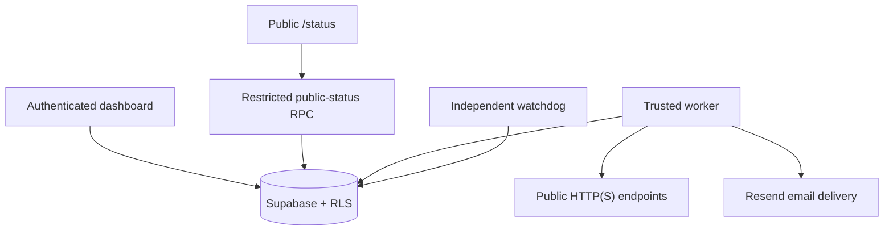

# StackPulse

**StackPulse** is a working AVISHKAR'26 **Uptime Monitor & Public Status Page** prototype. Register a public HTTP/HTTPS URL or API endpoint, choose an expected HTTP status and check interval, and let a separate worker collect real results. The dashboard displays uptime, response latency, HTTP status, TLS certificate expiry, incidents, and worker health. Owners can publish selected monitors on a read-only status page.

## What works

| Capability | Implementation |
| --- | --- |
| Authentication | Supabase email/password auth and protected Next.js dashboard |
| Monitor management | Owner-scoped create, edit, activate/pause, public/private visibility, and delete |
| Automated checking | Node.js worker checks public HTTP(S) endpoints at configured 30/60/120-second intervals |
| Recorded measurements | Real HTTP status, latency, success/failure, check time, and TLS expiry when available |
| Dashboard | Actual check history, 24-hour measured uptime and Recharts latency graphs; refreshes periodically |
| Incidents | Three consecutive failures open an incident; a successful check resolves it |
| Notifications | In-app incidents/notifications; opt-in incident-open and incident-recovery emails through Resend |
| Public status | Anonymous read-only `/status` with 24-hour coverage bars and incident timeline for opted-in public monitors |
| TrustPulse | Worker heartbeat age, liveness and fresh-check coverage, including delayed/offline states |
| Test utilities | Isolated controllable demo service, independent watchdog, automated worker tests |

**Verified live:** A deliberately failing endpoint returned HTTP 404 instead of the expected 200; StackPulse opened an incident and the critical email arrived in Gmail. After the endpoint recovered, the incident was resolved and Resend reported the recovery message delivered; Gmail classified that message as Spam. The email test used Resend's testing sender, not a production verified domain.

## Architecture

- **Frontend:** Next.js 16, React, TypeScript, Tailwind CSS, Recharts, Zod.
- **Backend/persistence:** Supabase PostgreSQL, Auth, Row Level Security (RLS), and narrowly scoped database RPCs.
- **Monitor worker:** Separate Node.js/TypeScript service, cron-style scheduling, safe HTTP(S) checks and incident handling.
- **Email:** Resend, with opt-in preferences and a leased email-only delivery queue.
- **Optional tools:** Independent worker-heartbeat watchdog and controlled demo endpoint.



No sample or synthetic checks are displayed as if they were real monitor results. If checks are missing or stale, the UI reports absent coverage or unknown/stale status.

## Prerequisites

- Node.js and npm
- A Supabase project with Auth enabled
- A trusted environment for the always-running worker
- Optional: Resend account/API key for email alerts

Never put a Supabase **service-role** key or Resend API key in browser code, `web/.env.local`, Git commits, or screenshots.

## Database migrations — important

Review SQL in `supabase/migrations/` before execution. Migrations are **not** automatically applied when the app starts.

For the existing email-only prototype database, the reviewed path was:

1. `001_initial_schema.sql`
2. `002_public_status.sql`
3. `003_trustpulse_health.sql`
4. `004_notifications.sql`
5. `009_email_only_delivery_baseline.sql`
6. `010_fix_email_claim_types.sql`

**Do not blindly run every migration by filename.** Historical committed migrations `005`–`008` include Telegram and earlier notification-delivery experiments. They were intentionally **not** applied to the known database used for the email-only demo. Follow [docs/EMAIL_ONLY_MIGRATION.md](docs/EMAIL_ONLY_MIGRATION.md) and inspect your database before choosing a path. A new database deployed with an automated migration runner needs an explicitly reconciled migration history; do not silently skip versions or delete existing Telegram objects/data.

Migration `010` corrects PostgreSQL `42804` in the email claim RPC by matching the declared return-column types. The email claim function is executable by the service-role worker, not anonymous or authenticated browser roles.

## Local setup

### 1. Frontend

Create `web/.env.local` (from your own Supabase project settings):

```dotenv
NEXT_PUBLIC_SUPABASE_URL=https://YOUR_PROJECT.supabase.co
NEXT_PUBLIC_SUPABASE_PUBLISHABLE_KEY=YOUR_PUBLISHABLE_KEY
```

In a terminal:

```powershell
cd web
npm install
npm run dev
```

Visit [http://localhost:3000](http://localhost:3000), sign in, and create a monitor. Only intentionally public monitors appear at [http://localhost:3000/status](http://localhost:3000/status); this local URL is not a hosted deployment.

### 2. Monitoring worker

Copy `worker/.env.example` to **`worker/.env`** and fill in the existing server-side credentials:

```dotenv
WORKER_SUPABASE_URL=https://YOUR_PROJECT.supabase.co
WORKER_SUPABASE_SERVICE_ROLE_KEY=YOUR_SERVICE_ROLE_KEY
WORKER_ID=stackpulse-worker-1
WORKER_TIMEOUT_MS=10000
WORKER_MAX_RESPONSE_BYTES=1048576
WORKER_DATABASE_RETRY_ATTEMPTS=3
WORKER_DATABASE_RETRY_BASE_MS=200
RESEND_API_KEY=
RESEND_FROM_EMAIL=
WORKER_EMAIL_POLL_MS=15000
```

Leave Resend fields unset if you are not configuring email delivery. For the restricted Resend test sender, `RESEND_FROM_EMAIL=onboarding@resend.dev` can be used with an eligible test recipient; production sending requires an appropriately verified sender domain and suitable deliverability configuration. Keep `worker/.env` private.

In a **separate** terminal:

```powershell
cd worker
npm install
npm run check
npm test
npm start
```

Run **one worker instance** for this local prototype. The worker checks active monitors, persists results, and records a heartbeat approximately every 60 seconds.

### 3. Opt in to email notifications (optional)

1. Sign in to StackPulse and open **Settings → Email notifications** (`/settings/notifications`).
2. Enable incident-open and/or incident-recovery emails and save.
3. Ensure the email delivery migrations are applied and the worker has valid Resend credentials.
4. A **new** eligible incident event is required to enqueue an email. Historical notifications are not automatically resent.

The email is addressed to the authenticated owner's Supabase Auth email. `RESEND_FROM_EMAIL` is the sender, **not** the recipient. Database `delivered` means the provider accepted the send; inbox placement is independently controlled by the receiving mail service.

## Reproduce the end-to-end demo

1. Sign in and create one monitor for `https://example.com/` with expected status **200**.
2. Create another for a deliberately nonexistent path such as `https://example.com/stackpulse-demo-404`, expected status **200**, with a **30-second** interval.
3. Watch the worker record successful HTTP 200 and failed HTTP 404 checks.
4. After three consecutive failures on the second monitor, observe the opened incident and (if opted in) its critical email.
5. Edit that monitor to use `https://example.com/` with expected status **200**. After a successful check, verify the incident resolves and a recovery email is queued.
6. Inspect the real latency chart, incident timeline, and the public `/status` page for monitors you've explicitly marked public.
7. Stop the worker and wait over three minutes to see TrustPulse report the heartbeat as offline; restart it to recover.

A dedicated controllable service is documented in [demo/README.md](demo/README.md). The worker intentionally blocks localhost/private-IP targets, so use an approved **public** HTTPS URL for monitoring rather than weakening SSRF rules.

## Security

- Supabase RLS and authenticated user IDs scope private monitor CRUD and queries to their owner.
- The worker's service-role key is server-only and never used in the frontend.
- The public status RPC exposes limited status metadata only for opted-in monitors, not endpoint URLs or credentials.
- The worker validates DNS on each request, rejects local/private/reserved addresses, pins a validated public IP, preserves TLS hostname verification, disables redirects, and enforces request-time and response-size limits.
- Email preferences require an explicit opt-in; queue claiming uses a service-role-only RPC with leases and `FOR UPDATE ... SKIP LOCKED`.
- Error logging avoids raw secrets, recipients, URL paths/queries, and notification bodies.

## Verification

From each relevant project directory:

```powershell
cd web
npm run lint
npm run build
```

```powershell
cd worker
npm run check
npm test
```

```powershell
cd watchdog
npm run check
npm test
```

```powershell
cd demo
npm run check
```

Run `git diff --check` from the repository root. The worker suite reported **22 passing tests** during the final local verification; frontend lint/build, watchdog checks/tests, and demo TypeScript check were also reported passing during development. Live email-open and recovery flows were manually exercised with real Supabase records and Resend.

## Current limitations and next steps

This is a **working local hackathon prototype**, not a 24/7 hosted service. The web app and always-on worker would need separate deployments and proper secret management to stay available when the development laptop is off. Production email sending needs a verified domain; Spam filtering cannot be guaranteed away. Production hardening would also include worker redundancy/distributed locking, quotas, outbound network egress controls, alerting for monitoring failures, and operational logging/backup plans.

For deeper details see [worker/README.md](worker/README.md), [watchdog/README.md](watchdog/README.md), [docs/IMPLEMENTATION_STATUS.md](docs/IMPLEMENTATION_STATUS.md), and [DEMO_TESTING_GUIDE.md](DEMO_TESTING_GUIDE.md).
